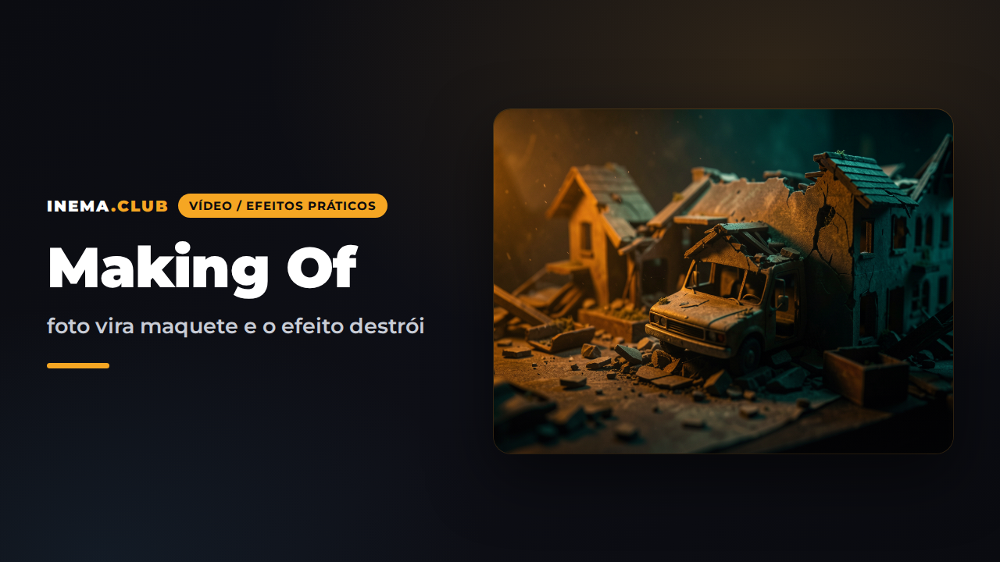
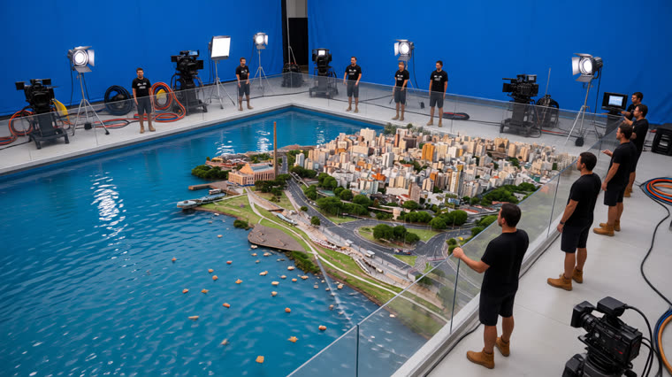
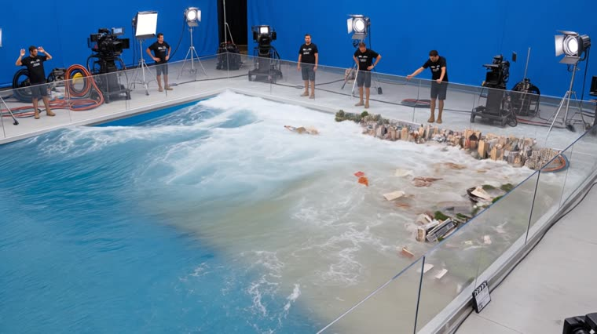

# video-making-of-skill



## 📖 Guia de uso

Guia completo (landing + passo a passo): **https://inematds.github.io/video-making-of-skill/guia/**

---

Transforma **uma foto de referência** num vídeo *behind-the-scenes* ultra-realista de efeito
prático: a coisa da foto vira **maquete** dentro de um rig de estúdio (tanque de ondas, mesa
sísmica, barras de fogo…), e o efeito destrói a maquete enquanto a equipe filma de longe.

| keyframe A — a maquete montada | o resultado — a onda destruindo |
|---|---|
|  |  |

Vídeo de 15s gerado por esta receita: [`guia/assets/v2-kling.mp4`](guia/assets/v2-kling.mp4)
(ou assista no [guia](https://inematds.github.io/video-making-of-skill/guia/#video)).

Baseado no guia AVCC de destruição de miniatura em tanque de ondas (`doc/`), corrigido pelo
que foi **medido** gerando ~15 clipes reais em dois provedores.

## A descoberta central

> O gerador de vídeo tem que receber a **maquete já montada** como primeiro frame — não a foto
> de referência.

Teste controlado, mesmo prompt integral do guia, mesma imagem de origem:

| | A — foto crua | B — maquete como frame inicial |
|---|---|---|
| abertura | a cidade real, intacta | estúdio, maquete fiel |
| destruição | prédios **se dissolvem no lugar**, em cubos | prédios **quebram** e são arrastados |
| onda | nenhuma | vem do lado da água aberta, atravessa lateralmente |
| final | tanque vazio (sem nunca mostrar maquete nem onda) | base raspada + destroços |

Com a foto crua o modelo entende *"transformar esta foto"*, não *"construir uma maquete disto"* —
e nem o prompt integral com os 15 negativos vira esse jogo. Por isso o pipeline tem duas etapas.

## Pipeline

```
foto de referência
   └─ scripts/kf_a.py ──────────────►  kf_a.png   (maquete montada no rig — Agnes, US$ 0)
                                          │
                        ┌─────────────────┴─────────────────┐
        scripts/render_kling.sh                  scripts/render_agnes.py
        (Kling v3_0, plano único)                (interpolação 3 keyframes, US$ 0)
```

```bash
# 1) a maquete (o --lock você escreve olhando a foto, em inglês, prédio a prédio)
scripts/kf_a.py doc/poa2.jpg out/kf_a.png --ratio 16x9 --efeito onda \
  --lock "the same orange-brick riverside power-plant hall, the same tall slender chimney, \
          the same white apartment blocks behind the treeline, the same curved promenade"

# 2) o filme
scripts/render_kling.sh out/kf_a.png out/filme.mp4 prompts/avcc-ondas-16x9-en.txt
```

## Os dois provedores

| | Kling (`render_kling.sh`) | Agnes (`render_agnes.py`) |
|---|---|---|
| modelo | `kling-video-v3_0`, assinatura Pro/SVIP | `agnes-video-v2.0` |
| custo | créditos do plano | **US$ 0** |
| modo | image-to-video de 1 frame + texto | só `mode: keyframes`, **2 a 3 imagens** |
| áudio | nativo, no mesmo passe | não |
| força | onda com física de verdade, plano contínuo | maquete fiel, iteração barata |
| fraqueza | ancora o frame 1 na imagem dada | interpola = morfa; sem 3º keyframe a onda some |

Receitas detalhadas, com as falhas medidas de cada um: `doc/receita-kling.md` e
`doc/receita-agnes.md`. A variante com multi-shot e água em slow motion (boa, mas viola o
guia): `doc/variante-kling-v2.md`.

## Regras que custaram caro

- **Prompt sempre em inglês.** Em PT a Agnes bloqueia prompt legítimo com HTTP 400.
- **Nada de `--tailImage` / A→B puro.** Frame final obrigatório faz o modelo *morfar* em vez de
  simular: a destruição chega por trás e os prédios se dissolvem. Custo de tirar: o "nada resta"
  deixa de ser garantido.
- **A água não escala.** Dizer "miniature" para tudo miniaturiza também a água (espuma de
  banheira). Só os prédios são maquete; a água é massa real.
- **A geometria manda mais que o texto.** "A onda vem do lado da água aberta" não adianta se o
  `kf_a` mostra a maquete como ilha cercada de água: sai onda de dois lados. A maquete tem que
  encostar em uma borda, com uma faixa larga de água aberta num lado só.
- **Kling: sempre `--poll 0` + `query_tasks`.** O poll longo cai (3 de 9 jobs) enquanto o job
  pago termina normal. Grave o `generation_id` antes de qualquer parse.

## Skills

Vivem em `skills/`, dentro deste repo:

- **`making-of-tanque-ondas`** — o caso AVCC: destruição de maquete em tanque de ondas.
- **`making-of-simulacao`** — genérica: qualquer simulação prática (fogo, terremoto, explosão,
  neve, vento) com a mesma estrutura de dois estágios.

Para instalar no Claude Code, aponte `~/.claude/skills/` para elas por symlink — assim editar
num lugar edita no outro e a skill nunca sai de sincronia com o código que ela descreve:

```bash
ln -s "$PWD/skills/making-of-tanque-ondas" ~/.claude/skills/making-of-tanque-ondas
ln -s "$PWD/skills/making-of-simulacao"    ~/.claude/skills/making-of-simulacao
```

## Pré-requisitos

`AGNES_API_KEY` em `~/projetos/agnes-nei/.env` · CLI `kling` logado (`kling who_am_i`) ·
`ffmpeg`/`ffprobe` no PATH.

## Estrutura

```
doc/       guia AVCC original (PT/EN), receitas medidas, fotos de referência
prompts/   prompts prontos, em inglês, validados
scripts/   kf_a.py · render_kling.sh · render_agnes.py
skills/    making-of-tanque-ondas · making-of-simulacao
guia/      a página publicada (landing + guia) + assets
```
